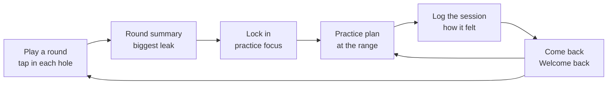
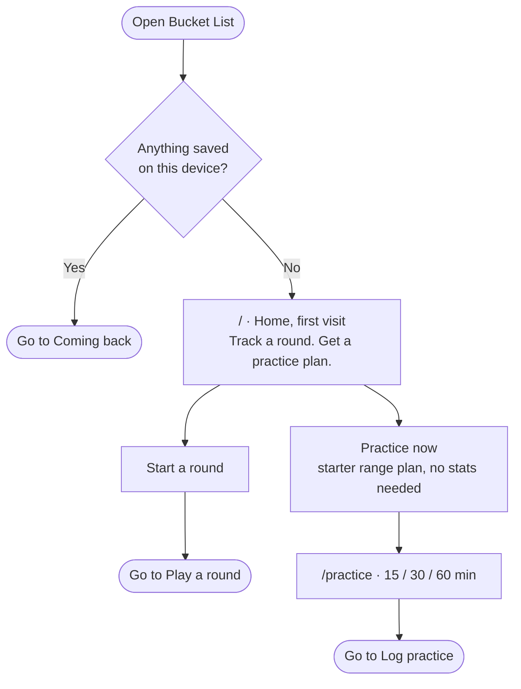
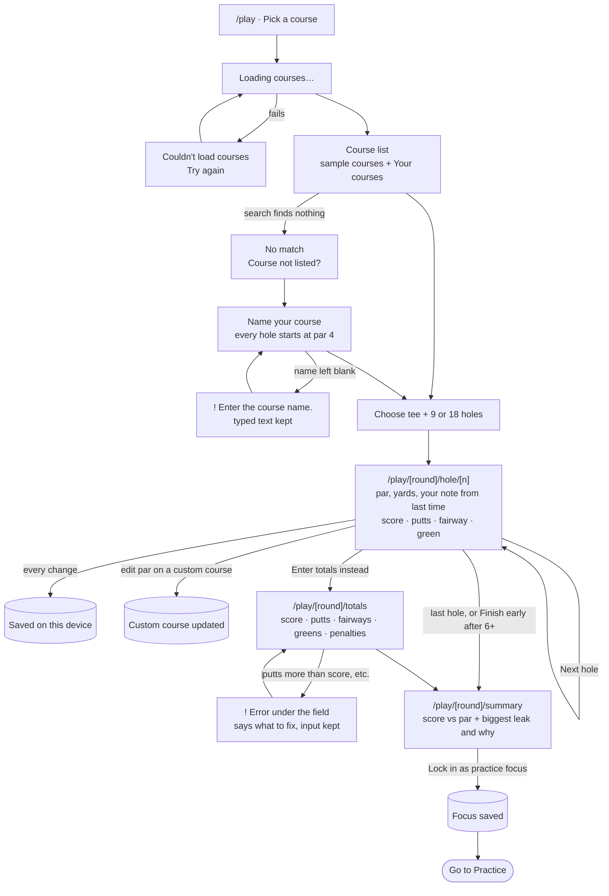
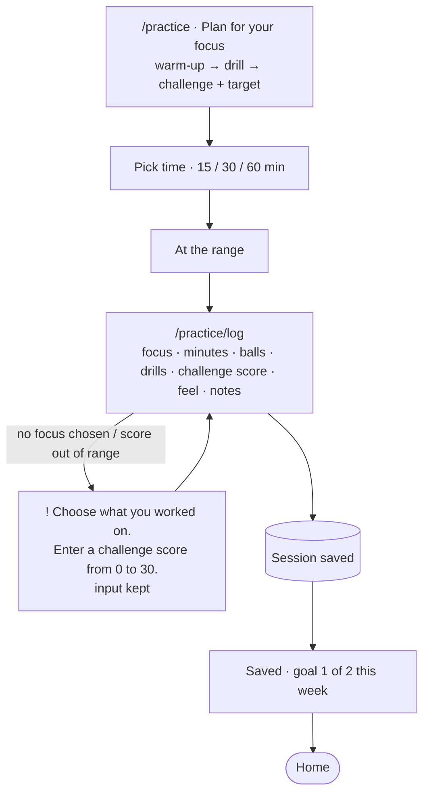
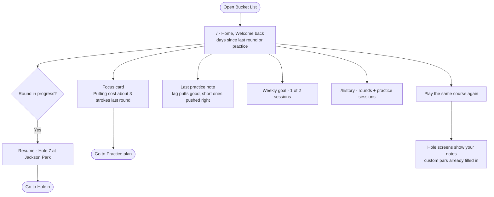

# Bucket List ⛳

*Log your round hole by hole, find out what cost you strokes, and take a plan to the range.*

Bucket List is a small golf tool for two rhythms: the weekend round and the weeknight range session. During a round you tap in each hole. Course data (par, yards, handicap) comes from a built-in course list, so there's no scorecard to type in. Afterwards it names the one area that cost you the most strokes and turns it into a practice plan. At the range you log how the session went. Everything is saved in your browser, so it remembers you next time on the same device.

> I tap in each hole as I play → the summary shows what cost me the most strokes → next time I'm at the range it gives me a plan for that → I log how practice went, and it's all waiting when I come back.

- **Live:** _coming soon (Vercel)_
- **Stack:** Next.js, Tailwind CSS and `localStorage`. No accounts, database or external APIs. The course "database" is sample data bundled with the app.

## Flows

The full set of diagrams, plus the steps, states and errors chosen during planning, is in [`flows.md`](flows.md).

### Overview: the loop


### First visit


### Core task: play a round → get a focus


### Practice: plan → log


### Coming back


## Onboarding research

Subagents studied how 18Birdies, Arccos Caddie and Break X Golf welcome someone new. The findings and the patterns borrowed are in [`docs/research.md`](docs/research.md). In short, Bucket List skips the setup wall all three use and gives value before you've logged anything: a starter practice plan on the first visit.

## Design

The visual style builds on my Assignment 2 **Clubhouse Almanac** design system, revised after class feedback:
- A white background and cards, with cream and tan kept for accents (the feedback: too much tan, and light text was hard to read on beige).
- Two typefaces and four text styles (the feedback: around 10 typographies made the hierarchy hard to follow).
- Red is used only for errors, always with an icon, and every text color is contrast-checked.

## Accessibility

_To be filled in: keyboard walkthrough results and contrast checks._

## First-run check

_To be filled in after deploy: an agent tries the live site as a brand-new user, and its usability feedback and the resulting changes go here._

## Running locally

```bash
npm install
npm run dev
```

Open http://localhost:3000.
