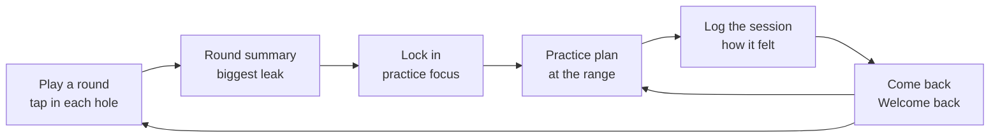
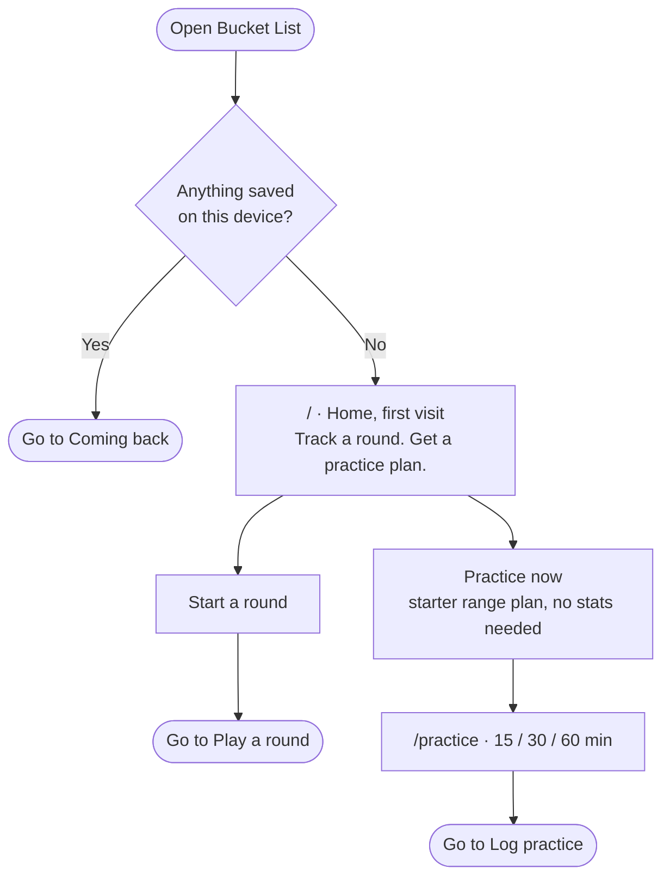
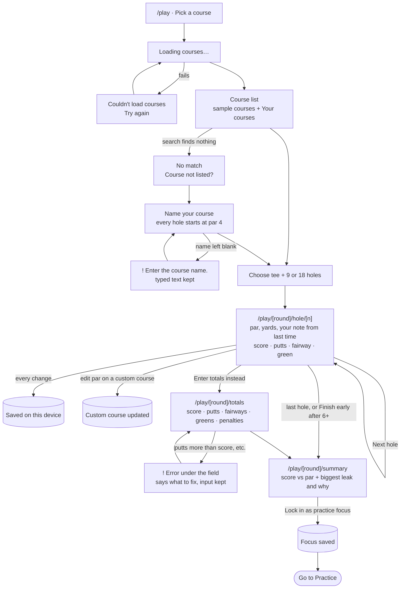
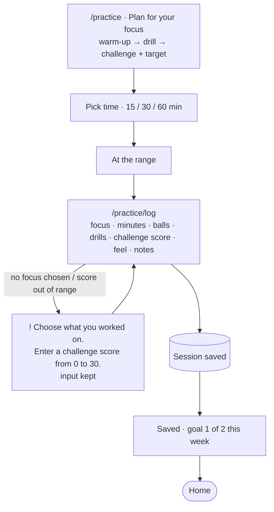
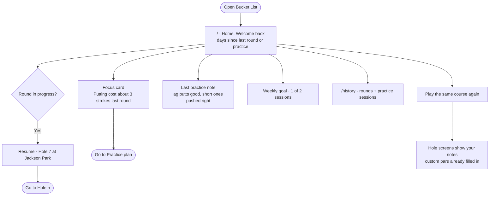

# Bucket List: user flows

**Core flow, in one sentence:**

> I tap in each hole as I play → the summary shows what cost me the most strokes → next time I'm at the range it gives me a plan for that → I log how practice went, and it's all waiting when I come back.

Each box with a route (`/play`, `/practice/log`, …) is its own page in the app. Rounded boxes link to another diagram. Cylinders are writes to `localStorage`.

## Overview: the loop

## 1 · First visit (nothing saved)

## 2 · Core task: play a round → get a focus

## 3 · Practice: plan → log

## 4 · Coming back (something saved)

## Steps, states, and errors added while planning with the agent

I asked the agent what steps, states and errors it would add, then chose which to keep:

| Added | Why |
|---|---|
| Course loading and load-error states | The course "database" is faked as an async call, so there's a real loading/retry moment |
| Search empty state → "Course not listed" | No dead ends when your course isn't in the list |
| Custom courses | Pars you set for an unlisted course are saved and reused next time |
| Autosave every hole + Resume card | Phones die mid-round, and the round can't be lost |
| Finish early after 6+ holes | From Arccos: you still get a useful summary from a partial round |
| Green prefilled from score − putts; fairway hidden on par 3s | From 18Birdies: fewer taps per hole |
| Totals fallback with cross-field errors | For when you forgot to track hole by hole |
| Practice-now starter plan on the first visit | From Break X: value before you've logged anything |
| Weekly goal instead of a daily streak | A forgiving reason to return, not guilt |
| Hole notes from last time on the hole screen | Course memory: the reason to open it on the course again |
| JSON export on History *(stretch)* | localStorage can be cleared, so give people a way out |
